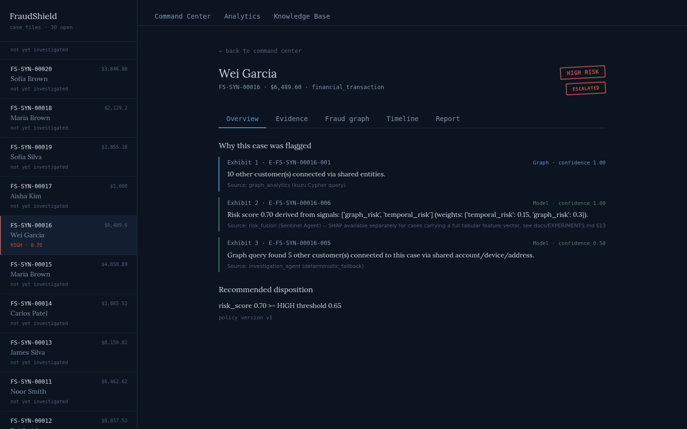

# FraudShield

**Multi-Agent AI for Explainable Fraud Detection, Investigation & Autonomous Case Management**

> Detect → Investigate → Explain → Document → Route

FraudShield is a fraud investigation platform, not just a fraud predictor.
It combines real machine-learning fraud detection (trained on the actual
IEEE-CIS and vehicle-insurance benchmark datasets) with graph-based
relationship analysis, temporal anomaly detection, document verification,
retrieval-augmented regulatory knowledge, and a five-agent investigation
pipeline that produces a traceable evidence dossier and an evidence-backed
report — then routes the case according to configurable policy.

FraudShield is positioned as an **AI-assisted investigation and
case-management platform that automates repetitive investigative work
while preserving evidence traceability and human oversight**. It does not
claim to prove criminal fraud, and its language throughout uses "risk
indicator" / "requires review" rather than accusatory framing.

This README is updated at the end of every build phase — see
`docs/PROGRESS.md` for the phase-by-phase status and `docs/DATASET.md` /
`docs/EXPERIMENTS.md` for the real data and real metrics behind the
claims made here.

---

## Current status: Phases 0–18

| Phase | Status |
|---|---|
| 0. Architecture & scaffold | ✅ |
| 1. Backend foundation (FastAPI/SQLite/SQLAlchemy; PostgreSQL ORM smoke-tested) | ✅ |
| 2. Dataset pipeline (real IEEE-CIS + carclaims + synthetic scenarios) | ✅ |
| 3. Baseline fraud models (real metrics, both domains) | ✅ |
| 4. Graph construction, GraphSAGE training and GNNExplainer | ✅ (20K-node sample; CPU) |
| 5. Velocity detection and LSTM sequence training | ✅ (30K-row splits; CPU) |
| 6. Document AI — real OCR, validation, duplicate detection | ✅ |
| 7. Knowledge graph store — real Cypher on kuzu; Neo4j adapter smoke-tested | ✅ |
| 8. RAG knowledge base — real ChromaDB | ✅ |
| 9. Five agents + LangGraph — real orchestration, real tool calls | ✅ |
| 10. Explainability — SHAP and GNNExplainer | ✅ |
| 11. PDF report generation — real ReportLab, verified via text round-trip | ✅ |
| 12. React dashboard — real, screenshotted against live data | ✅ |
| 13. WebSocket live updates — real LangGraph streaming | ✅ |
| 14. Synthetic scenario engine | ✅ (delivered in Phase 2, cross-referenced) |
| 15. Full integration — API wired to the real pipeline, verified live over HTTP | ✅ |
| 16. Testing (unit/integration/e2e) | ✅ |
| 17. Docker | ✅ Compose images built and smoke-tested live |
| 18. Final documentation | ✅ |

All 18 phases have implementation work recorded. The currently verified
backend test status and its limits are in `docs/TESTING.md`; the dashboard
was separately verified through live Playwright screenshots (see below).

(Phase 15 was pulled forward, ahead of the frontend, deliberately: it makes no sense to build a React dashboard against API endpoints that have never actually been proven to work together. That integration gap was real — through Phase 11 the API was a bare CRUD shell, never connected to the 5-agent pipeline at all.)

### The dashboard, for real



Real HIGH RISK / ESCALATED ink-stamp marks, real ranked exhibits with real evidence IDs, real routing reason — all from an actual investigated case in a live-seeded database, not mock data. See `docs/screenshots/` for the Evidence and Fraud Graph tabs too, and `docs/EXPERIMENTS.md` §19 for how they were captured and the real performance bug (a 10.5-second OCR re-computation on every investigate call) found and fixed while testing it live.

### Neural-model evaluation caveat

The checked-in GNN and LSTM are trained on bounded samples using CPU.
GraphSAGE test PR-AUC is 0.2067 and the LSTM test PR-AUC is 0.0486; neither
beats the same-row XGBoost baseline. Three-signal fusion also underperforms
XGBoost alone on that evaluation. These are measured results, not evidence
that the neural models improve detection; larger samples and calibrated
validation are still needed. See `docs/EXPERIMENTS.md` and the reproducible
commands in `docs/RUN_GNN.md` / `docs/RUN_TEMPORAL.md`.

---

## What's real right now

- **Real datasets, not synthetic stand-ins.** The actual Kaggle IEEE-CIS
  `train_transaction.csv` (590,540 rows) + `train_identity.csv` (144,233
  rows), and a real vehicle-insurance-claims benchmark (`carclaims.csv`,
  15,420 rows). Full provenance, license notes, and measured statistics
  (row counts, fraud rates, missingness) are in `docs/DATASET.md` — not
  assumed, computed directly from the files.
- **Real trained models with real metrics.** Logistic Regression, Random
  Forest, and XGBoost trained on IEEE-CIS; Logistic Regression and Random
  Forest on carclaims, plus sampled GraphSAGE and LSTM runs. Full
  precision/recall/F1/ROC-AUC/PR-AUC/confusion-matrix/false-positive-rate
  results — including the honest ones (carclaims' best model has a 33.5%
  false-positive rate; that's reported, not hidden) — are in
  `docs/EXPERIMENTS.md`.
- **A working backend** (FastAPI + SQLAlchemy) implementing the exact
  unified schema from the project spec (cases, transactions, claims,
  agent_executions, evidence, reports, decisions), with `data_source` /
  `scenario_id` provenance tracking so the dashboard can
  always distinguish public-benchmark data from synthetic demonstration
  data, per the spec's explicit requirement.
- **Manual case intake** from the dashboard or API. Positive amounts and
  matching case domains are validated; optional transaction/claim IDs
  create linked source records. Cases with no usable risk signals remain
  unscored and go to human review rather than being treated as low risk.
  The benchmark-trained GNN and LSTM are not applied to these manual
  records.
- **A real synthetic scenario library** — not because synthetic data was
  easier, but because the public benchmarks above don't provide
  multi-entity fraud-ring relationships, document mismatch, or duplicate-invoice
  artifacts in usable form. 8 scenarios, 3 CSVs, every row tagged and
  traceable — see `data/synthetic/` and `docs/DATASET.md` §3.

### Key measured findings so far

- **XGBoost baseline (IEEE-CIS)**: ROC-AUC 0.886, PR-AUC 0.471, catching 68.4% of fraud at a 9.6% false-positive rate.
- **Graph structure carries real signal**: transactions inside a connected ring have a 3.79% fraud rate vs 2.53% outside (1.5× lift) — and **17 rings are 100% fraud**, including one 17-transaction component where every member is fraudulent. That's coordinated structure a per-transaction model cannot see.
- **Temporal signal is weak but independent**: ROC-AUC 0.55–0.62 standalone (barely above random, reported as such), but flagged transactions carry ~1.6× the fraud rate consistently across all three splits.
- **Neural model results do not beat XGBoost**: GraphSAGE PR-AUC 0.2067 on a 20K-node test sample; LSTM PR-AUC 0.0486 on a 30K-row test sample. On a shared 20K-row test set, three-signal fusion PR-AUC is 0.3729 versus 0.4956 for XGBoost alone.
- **Document AI works end-to-end with real OCR**: tesseract 5.3.4, mean confidence 0.949, 100% invoice-number extraction, and it caught 2/2 planted amount mismatches and 5/5 duplicate invoices with zero misses.
- **Graph queries separate risk cleanly**: real Cypher on kuzu gives mean strong-connections of 3.23 (HIGH) vs 1.71 (MEDIUM) vs 0.00 (LOW).
- **And the graph misses things — measured, not hidden**: the duplicate-invoice scenario has zero shared entities and is invisible to graph analysis. That's the empirical case for risk fusion, with a test asserting the limitation stays visible.
- **RAG retrieval on real ChromaDB**: 90.9% accuracy@3 across 11 queries, with one documented failure (a paraphrase TF-IDF genuinely can't catch) locked in as a permanent regression-guard test rather than swept away.
- **The 5-agent LangGraph pipeline ran end-to-end on 30 synthetic cases**: 100% workflow completion (zero crashes), 86.7% routing consistency against designed scenario outcomes. Gemini genuinely failed (403 Forbidden, verified live) on every full-pipeline case, and the system correctly fell back to deterministic templates instead of crashing — real coverage of the spec's error-handling requirement, not simulated. Found and fixed 2 real bugs (a Case Commander field mismatch, missing cross-case duplicate wiring) and corrected one of my own unvalidated Phase-2 scenario labels rather than forcing the system to match a guess. One honest gap remains (Scenario 6, address-only sharing) — deliberately not curve-fit away.
- **Real SHAP against the real trained models**: confirmed-fraud test transactions consistently score higher than confirmed-legitimate ones across all 3 models, and the top global features (C1/C5/C13/C14) match independently-published community findings on this exact dataset — an external sanity check, not just internal consistency.
- **PDF reports generated and verified by extracting their text back out**: 6/6 representative cases pass round-trip content verification (pdfplumber), catching the class of bug that "file exists" checks miss. Visually inspected, not just automated — see the rendered example in `docs/EXPERIMENTS.md` §15.
- **The full stack works together, verified live over real HTTP, not just in isolated scripts**: seed → investigate (real 5-agent run) → persisted AgentExecution/Evidence/Report/Decision rows → real Cypher-backed fraud graph → real downloadable PDF → live analytics. Found and fixed 2 real bugs doing this: a startup race condition in my own test script, and a genuine primary-key collision on re-investigating a case (now idempotent, regression-tested).
- **Real-time WebSocket agent events, with a real concurrency bug found and fixed**: an early version broadcast every agent's summary as the *last* agent's summary, because 5 agent functions mutate one shared state dict and the stream was drained eagerly before broadcasting. Caught with a live `websockets` client, fixed with a thread-to-asyncio-queue bridge, now locked in as a regression test. A second bug (the frontend's WebSocket silently never reaching the backend — a missing `/ws` proxy entry) was found the same way: by actually testing in a browser, not assuming the code was correct.

The bounded fusion experiment is now measured: on the same 20K test
transactions, default XGBoost + GraphSAGE + LSTM fusion scores PR-AUC
0.3729 versus 0.4956 for XGBoost alone. The current result does not
support deploying those fusion weights as calibrated policy; details
and limitations are in `docs/EXPERIMENTS.md`.

## Remaining implementation and verification gaps

The case-level graph, evidence dossier, and KB search exist. Evidence
exhibits now expose their structured source references in an expandable
trace panel, but there are no direct links into source documents/records.
The dashboard still lacks a standalone Fraud Ring Explorer, a KB
document-upload flow, and an ROI calculator. PostgreSQL ORM CRUD and
Neo4j adapter queries passed basic live-service smoke checks, but full
application workflows on those backends remain unverified. A successful
Gemini response still requires a valid API key. See `docs/PROGRESS.md`
and `docs/EXPERIMENTS.md`.

---

## Repository structure

```
FraudShield/
├── backend/
│   ├── app/
│   │   ├── main.py              # FastAPI entrypoint
│   │   ├── api/cases.py         # case CRUD endpoints
│   │   ├── core/config.py       # env-driven settings (DB, graph, RAG, LLM)
│   │   ├── database/            # SQLAlchemy models + session (Phase 1)
│   │   ├── schemas/             # Pydantic request/response models
│   │   ├── agents/               # five-agent LangGraph workflow
│   │   ├── ml/{baseline,gnn,temporal,document,fusion}/
│   │   ├── graph/                # kuzu / Neo4j adapters
│   │   ├── rag/                  # ChromaDB knowledge base
│   │   └── explainability/       # SHAP, GNNExplainer, case summary
│   └── tests/
│       ├── test_api.py               # Phase 1 — 12 tests
│       ├── test_data_pipeline.py     # Phase 2 — 16 tests
│       └── test_baseline_models.py   # Phase 3 — 10 tests
├── frontend/                    # React dashboard
├── data/
│   ├── raw/{ieee_cis,carclaims}/     # your uploaded source files
│   ├── processed/                    # parquet splits + stats JSON (Phase 2 output)
│   └── synthetic/                    # 8-scenario CSV library (Phase 2 output)
├── models/baseline/              # trained model artifacts (Phase 3 output)
├── scripts/
│   ├── preprocess_ieee.py
│   ├── preprocess_carclaims.py
│   ├── generate_synthetic_scenarios.py
│   └── train_baseline.py
├── docs/
│   ├── PROGRESS.md               # phase-by-phase status, updated every phase
│   ├── DATASET.md                # real data documentation
│   └── EXPERIMENTS.md            # real model metrics
└── .env.example
```

---

## Setup & running what exists so far

### 1. Backend API

```bash
cd backend
python3 -m venv venv && source venv/bin/activate
pip install -r requirements.txt
uvicorn app.main:app --reload --port 8000
```

Health check: `GET http://localhost:8000/health`
Case API: `POST/GET http://localhost:8000/api/cases` (OpenAPI docs at `/docs`)

### 2. Reproduce the dataset pipeline

Place your IEEE-CIS + carclaims CSVs under `data/raw/ieee_cis/` and
`data/raw/carclaims/` (already done in this build), then:

```bash
cd FraudShield
python3 scripts/preprocess_ieee.py          # -> data/processed/ieee_cis_{train,val,test}.parquet
python3 scripts/preprocess_carclaims.py     # -> data/processed/carclaims_{train,val,test}.parquet
python3 scripts/generate_synthetic_scenarios.py  # -> data/synthetic/*.csv
```

### 3. Reproduce the baseline models

```bash
python3 scripts/train_baseline.py           # -> models/baseline/*.joblib, docs/*_baseline_metrics.json
```

Note: `os.cpu_count()` in this environment reports 1. Training completed
in under 90 seconds for every model here, but this is worth re-running
with more cores/RAM available for a production run.

### 4. Build the entity graph and temporal features (no PyTorch needed)

```bash
python3 backend/app/ml/gnn/graph_builder.py --sample-size 20000
python3 backend/app/ml/temporal/velocity_detector.py --sample-size 30000
```

### 5. Train and evaluate the neural models

The CPU-trainable runs and metric artifacts are checked in under
`models/gnn/`, `models/temporal/`, and `docs/`. To reproduce them, use
`scripts/train_gnn.py`, `scripts/train_temporal.py`, and
`scripts/evaluate_fusion.py`; guidance and measured tradeoffs are in
`docs/RUN_GNN.md`, `docs/RUN_TEMPORAL.md`, and `docs/EXPERIMENTS.md`.

### 6. Document AI (real OCR — runs here, no GPU needed)

```bash
python3 backend/app/documents/generator.py        # render synthetic invoices as PNGs
python3 scripts/evaluate_document_ai.py           # OCR + validate + score vs ground truth
```

Requires `tesseract` (`apt install tesseract-ocr`) and `pip install pytesseract pillow`.
To use PaddleOCR instead: `pip install paddlepaddle paddleocr` then `export OCR_BACKEND=paddleocr`.

### 7. Knowledge graph (real Cypher, embedded — no server needed)

```bash
pip install kuzu
python3 scripts/ingest_graph.py     # ingest scenarios + run fraud-ring Cypher queries
```

To use a real Neo4j server instead: `pip install neo4j`, start Neo4j, then `export GRAPH_BACKEND=neo4j`.

### 8. RAG knowledge base (real ChromaDB — runs here)

```bash
pip install chromadb
python3 scripts/evaluate_rag.py     # builds the index + runs retrieval evaluation
```

To use real neural embeddings instead of the offline TF-IDF substitute (once you have broader network access): `pip install sentence-transformers` then `export FRAUDSHIELD_EMBEDDING=sentence-transformers`.

### 9. The 5-agent pipeline (real LangGraph — runs here; LLM calls need your own Gemini key)

```bash
pip install langgraph google-generativeai
python3 scripts/run_agent_pipeline.py     # runs all 5 agents over all 30 synthetic cases
```

Without `GEMINI_API_KEY` set, Investigation and Report Architect automatically use their deterministic fallback (this is what the measured results above used). Set `GEMINI_API_KEY` in `.env` to enable real LLM synthesis — the client enforces the free-tier request budget from `.env.example` automatically.

### 10. Explainability (SHAP and GNNExplainer)

```bash
pip install shap
python3 scripts/evaluate_shap.py           # SHAP against the real trained Phase-3 models
python3 scripts/evaluate_explain_case.py   # "Explain This Case" against a real pipeline run
python3 scripts/evaluate_gnn_explainer.py --epochs 30
```

### 11. PDF reports (real ReportLab — runs here)

```bash
pip install reportlab pdfplumber pdf2image
python3 scripts/generate_reports.py     # generates + verifies PDFs for 6 representative cases
```

Output PDFs land in `reports/`.

### 12. Run the live backend and try it yourself

```bash
cd backend && uvicorn app.main:app --reload --port 8000
# in another terminal:
curl -X POST http://localhost:8000/api/cases/seed-synthetic
curl -X POST http://localhost:8000/api/cases/FS-SYN-00016/investigate
curl http://localhost:8000/api/cases/FS-SYN-00016/graph
curl http://localhost:8000/api/cases/FS-SYN-00016/report/pdf -o report.pdf
curl http://localhost:8000/api/analytics
```

Full interactive API docs at `http://localhost:8000/docs`.

### 13. Live WebSocket agent events (real-time, runs here)

Included automatically when you run the dashboard (step above) — click "Run investigation" on any case and watch the live agent feed populate via `WS /ws/cases/{case_id}`. Verify the protocol directly:

```bash
pip install websockets
# with the backend running, in a python shell:
# connect to ws://localhost:8000/ws/cases/{case_id}, then POST /investigate for that case
```

### 14. Run the dashboard

```bash
# with the backend already running on :8000 (previous step):
cd frontend
npm install
npm run dev
# open http://localhost:5173
```

### 14. Run the test suite

```bash
cd backend
python3 -m pytest tests/ -v
```

Current verified result: `196 passed, 0 skipped` in this environment.

---

## Further reading

- **`docs/ARCHITECTURE.md`** — system diagram, request-flow walkthrough, and design decisions made under real constraints.
- **`docs/TESTING.md`** — precisely what 71% coverage does and doesn't mean, broken down by test file.
- **`docs/PROGRESS.md`** — the phase-by-phase build log, updated after every phase actually ran.
- **`docs/DATASET.md`, `docs/EXPERIMENTS.md`** — every real dataset statistic and model metric in this project, with honest framing (including the unflattering numbers).
- **`docs/RUN_GNN.md`, `docs/RUN_TEMPORAL.md`, `docs/RUN_DOCKER.md`** — reproducible training and deployment guides, including the measured CPU runs.

## Design decisions carried over from environment constraints

- **SQLite is the default database**; PostgreSQL 16.15 schema creation and
  ORM CRUD have also passed a live adapter smoke test. Full API/Compose
  deployment with PostgreSQL is not yet verified.
- **Single-CPU-aware model sizes** — `n_estimators`/`max_depth` bounded in
  `scripts/train_baseline.py` because this environment reports 1 CPU core.
- **LLM provider is Gemini (free tier)**, not a paid API — the eventual
  agent pipeline is designed so LLM calls happen only once per
  *flagged* case (never per-transaction, never per-agent-per-case), to
  stay within free-tier rate limits (as low as 10 RPM / 500 RPD on some
  models). See `.env.example` for the request-budget configuration.
- **kuzu (embedded graph DB) and ChromaDB in embedded/persistent mode**
  are the local-first defaults. Both are real, non-mocked implementations
  of the interface. The Neo4j adapter also passed live schema and graph
  query smoke checks; see `.env.example`'s `GRAPH_BACKEND` setting. Full
  API/Compose deployment with Neo4j is not yet verified.

---

## Limitations (Section 63)

See `docs/DATASET.md` §4 and `docs/EXPERIMENTS.md` §4 for the full,
specific list of what is and isn't measured/validated so far. In brief:
both datasets are several years old and may not reflect current fraud
patterns; IEEE-CIS's unlabeled Kaggle test set cannot be used for
evaluation; carclaims lacks precise timestamps; the synthetic scenario
library is a small, hand-built test fixture, not a statistical sample.
