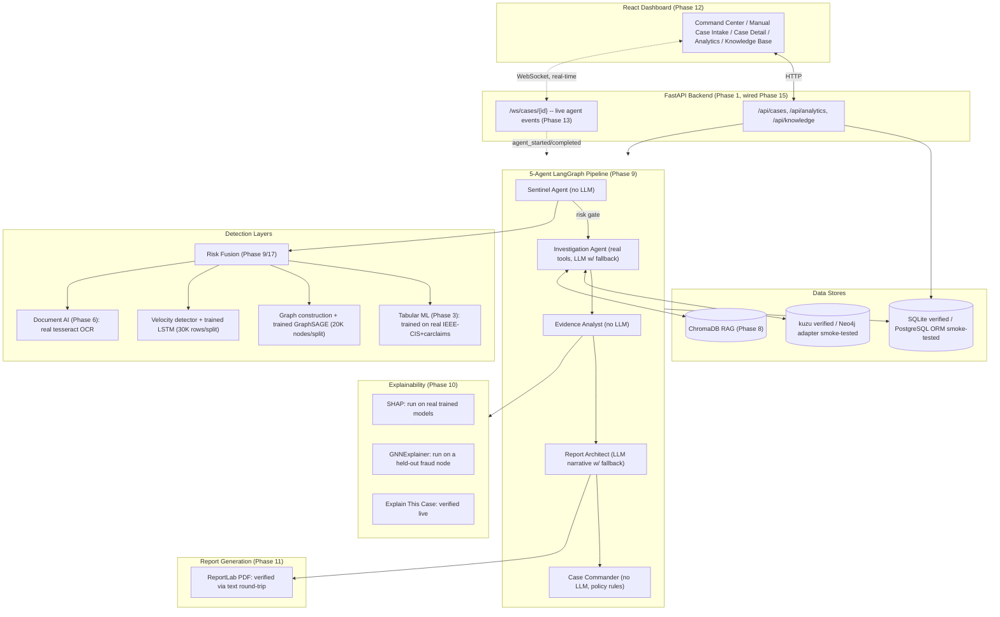

# Architecture

This diagram reflects what's built. GraphSAGE and the LSTM are trained on
bounded IEEE-CIS samples, but their checkpoints are used by offline
evaluation scripts only; manually entered cases do not consume IEEE-CIS
feature vectors. SQLite, PostgreSQL ORM CRUD, kuzu, Neo4j adapter queries,
and ChromaDB have been smoke-tested. A full API deployment against
PostgreSQL plus Neo4j has not been verified.

## Request flow: investigating one case

1. **User opens a case** in the dashboard or posts it to `POST /api/cases`. Optional transaction/claim IDs are stored as linked source records. A submitted case is then investigated from its detail view (or through `POST /api/cases/{id}/investigate`).
2. **FastAPI** loads the case, opens the graph store (kuzu) and knowledge base (ChromaDB) singletons.
3. **LangGraph's `.stream()`** runs the 5 agents in order, yielding after each one completes.
4. Each yielded step is **immediately broadcast** over the case's WebSocket subscribers (`agent_started` / `agent_completed`) — this is genuine per-node streaming, not simulated progress (see the real concurrency bug found and fixed in Phase 13, `docs/EXPERIMENTS.md` §21).
5. **Sentinel** queries the graph store for connections, checks for a matching document (OCR'd if present), computes a velocity heuristic from case timestamps, and fuses whichever signals are actually available into a risk score (`risk_fusion.py`).
6. If at least one risk signal is available, risk is negligible, and there's zero graph connectivity, the pipeline **short-circuits** straight to an auto-close decision — skipping the (rate-limited) LLM calls entirely. If there are no usable signals, the case remains unscored and routes to human review; missing evidence is not treated as low risk.
7. Otherwise, **Investigation** queries the graph again for the full connection list, queries the RAG knowledge base for relevant regulatory passages, and attempts an LLM synthesis (Gemini) that **falls back to a deterministic four-part template** if the LLM is unreachable — which it always is in the sandboxed dev environment (verified: 403 Forbidden), so this fallback path has been exercised for real, not just written.
8. **Evidence Analyst** compiles every finding into a structured, source-referenced evidence list.
9. **Report Architect** builds the structural report entirely from that evidence list (never inventing content), plus an optional LLM narrative paragraph.
10. **Case Commander** applies the routing policy (4 override rules, each recording its own trigger condition) and produces the final decision.
11. **All of the above is persisted**: `AgentExecution`, `Evidence`, `Report`, `Decision` rows, plus a generated PDF file.
12. The final `investigation_complete` WebSocket event fires, and the dashboard re-fetches the case detail.

## Why this shape, not a simpler one

- **Sentinel runs first and can short-circuit** specifically so the expensive, rate-limited LLM calls (free-tier Gemini: as low as 10 RPM / 500 RPD) are never spent on cases with no signal at all — a real constraint that shaped the architecture, not an afterthought.
- **Every "no LLM" agent is deliberately deterministic** (Sentinel, Evidence Analyst, Case Commander) — the spec explicitly rejects "5 chained LLM calls" as an anti-pattern, and this project takes that literally: only 2 of 5 agents ever call an LLM at all, and both have working fallbacks.
- **Risk fusion normalizes by available signal weight**, not a fixed denominator — a case that only has graph + document signals (no tabular ML score, because it's a synthetic scenario fixture rather than an IEEE-CIS-shaped transaction) still produces a correctly-scaled 0–1 score instead of one silently capped low.
- **The graph and SQL stores have configuration surfaces for switching backends** (kuzu↔Neo4j and SQLite↔Postgres); only kuzu and SQLite have been exercised. ChromaDB runs in embedded/persistent mode.
